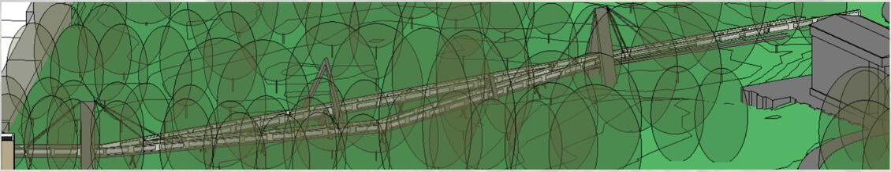

# Tawseef Masud — Civil Engineering Design Portfolio

Design work from **CIVE1665 Integrated Design Project** at the University of Leeds. There are three group projects, all for St George's Field on the Leeds campus.

🔗 **Live site:** https://YOUR-USERNAME.github.io

| # | Project | Highlights |
|---|---------|-----------|
| 01 | **Raised Walkway** | Cable-stayed route with weathering-steel pylons, a composite steel–concrete deck and a glass balustrade, modelled in Revit |
| 02 | **Pavilion** | Dragon-plan glass canopy on 45 steel columns, with a 1:5 connection detail, a 1:100 physical model and a ~£437k cost estimate |
| 03 | **Vertical Barrier** | Replacement for a 20 m gap in the boundary wall, with a strip-foundation bearing check and an overturning check |

**Tools:** Autodesk Revit · hand sketching · physical modelling

*All projects were group work completed with fellow students at the University of Leeds School of Civil Engineering.*
